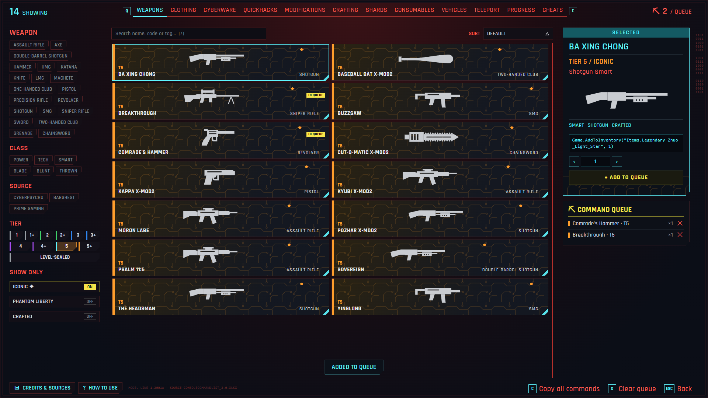

# CET Armory

A free, fan-made item browser for Cyberpunk 2077, styled like the in-game inventory. Find an item by its picture, queue it up and copy the Cyber Engine Tweaks console command.



**Live site:** https://mrerrorsan.github.io/cp2077-cet-armory/

## Features

- Visual browsing with item pictures instead of a wall of text
- Filter by type, class and slot
- Tiers 1 to 5++, plus Iconic and Phantom Liberty filters
- Search by name or by item code
- Group versions: one tile per item, pick the tier on the card (the highest is used by default)
- Weapons drill down by type and class (Pistol > Power / Tech / Smart); Clothing by slot and garment type
- Clothing that still gives Armor in 2.x (77 tactical helmets and vests) is marked, with an "Armor pieces" category
- Cheats are split into sections; every number in a command is a pre-filled field you can change
- Points can be taken back: negative amounts, plus Reset attributes / perks commands
- Pictures of weapons with nudity are hidden by default ("Hide nudity" toggle)
- Command queue with one-click copy
- Game-style navigation: click a category to open it, click an item to inspect it, right-click or Esc to go back
- Queue panel with Copy all, per-item copy and a preview of the full command line
- Keyboard shortcuts: Q / E / C / X / Esc, and `/` to focus search
- Works offline (pictures need a connection; without one, tiles show drawn icons)
- All 12 sheet tabs, including teleports, progress and cheats

## How to use

1. Install [Cyber Engine Tweaks](https://github.com/maximegmd/CyberEngineTweaks) for Cyberpunk 2077.
2. Open the CET console in game (default key is set in the CET overlay).
3. On the site, add items to the queue and press copy.
4. Paste into the console and press Enter.

## Run locally

Item pictures are loaded from the Cyberpunk Wiki by your browser. The wiki blocks pictures on pages opened straight from disk (`file://`), so for pictures run a tiny local server:

```
python -m http.server 8000 --directory site
```

then open http://localhost:8000/. Opening `site/index.html` directly still works; tiles then show drawn icons instead of pictures.

## Rebuild data

Requires Python 3 and Node.js. The only data source is `data/source/ConsoleCommandList_2.0.xlsx`.

```
python -I tools/build_data.py
python -I tools/fetch_images.py --hotlink
```

Tests:

```
python -I -m unittest discover -s tests
node --test tests/js/
```

## Project structure

```
site/     the website (index.html, css, js, fonts, data, img)
tools/    build_data.py, fetch_images.py
tests/    Python and JS tests
data/     source spreadsheet
docs/     plans, specs, screenshot
.github/  GitHub Pages workflow
```

## Credits

- Researched additions (not in the sheet), with their sources, are in `data/research/`: clothing armor from the Cyberpunk Wiki item pages, and the reset commands from CDPR's script source (CDPR-Modding-Documentation)
- Console command list by the CET team and the redmodding Discord #cet-support: https://wiki.redmodding.org/cyber-engine-tweaks/console/console/how-do-i
- [Cyber Engine Tweaks](https://github.com/maximegmd/CyberEngineTweaks)
- Item images from the Cyberpunk Wiki: https://cyberpunk.fandom.com
- Rajdhani font, SIL Open Font License

## Disclaimer

This is an unofficial fan project. It is not affiliated with or endorsed by CD PROJEKT RED. Cyberpunk 2077 assets and trademarks belong to CD PROJEKT S.A. Images are used under CDPR's fan content guidelines, and will be removed on request.

## License

The code is MIT licensed, see [LICENSE](LICENSE). Game assets are excluded, and the spreadsheet data belongs to its authors.
