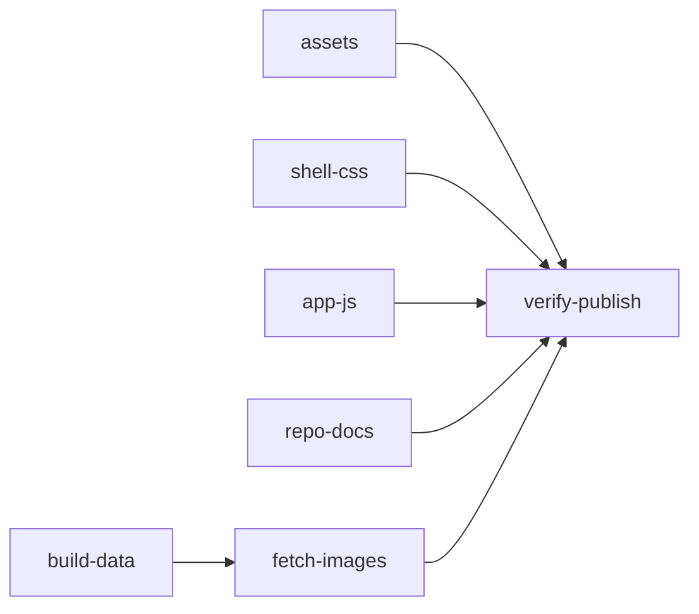

# CET Armory v1 Implementation Plan

> **For agentic workers:** execute via parallel subagents (Anvil). Implement only; the orchestrator verifies once.

**Goal:** Ship the site described in the spec, live on GitHub Pages.
**Architecture:** Python stdlib build scripts turn the xlsx into a `window.CET_DATA` JS file; a vanilla-JS
single page (classic `<script>` tags, no modules, no bundler) renders it. Works from `file://` and Pages.
**Tech stack:** Python 3.14 stdlib (`zipfile`, `xml.etree`, `urllib`, `unittest`), vanilla HTML/CSS/JS, Node 26 `node --test` for JS unit tests.
**Spec:** [docs/superpowers/specs/2026-11-16-cet-armory-design.md](../specs/2026-11-16-cet-armory-design.md), read it first; §6 contracts are binding.

## Global Constraints
- Only data source: `data/source/ConsoleCommandList_2.0.xlsx`. Never read other files in `data/source/`.
- No runtime network calls; no ES modules; no `fetch()` of local files (breaks `file://`). Scripts load in this order: `data/items.js`, `data/images.js`, `js/icons.js`, `js/filters.js`, `js/app.js`.
- Commands must match the sheet except the three normalisations in spec §6.
- Palette (CSS custom properties on `:root`): `--red:#ff5d52 --red-dark:#6b2226 --cyan:#5ef6ff --cyan-dark:#145a63 --yellow:#f7e64a --text:#d9dde2 --muted:#7d8590 --r-common:#9aa0a6 --r-uncommon:#3fd16a --r-rare:#2f86f0 --r-epic:#a64cf0 --r-legendary:#ff9e2c --bg-top:#3a1216 --bg-bottom:#0b0e17 --panel:#141821`.
- Font: `Rajdhani` 500/600/700 from `site/fonts/`, fallback `'Segoe UI', sans-serif`.
- Visual reference: mockup `.superpowers/brainstorm/445-1794828700/content/layout-v2.html` + game screenshots in the spec R1.

## Target Files
- [tools/build_data.py](../../../tools/build_data.py): xlsx → items.js / items.json
- [tests/test_build_data.py](../../../tests/test_build_data.py): unittest for the builder
- [tools/fetch_images.py](../../../tools/fetch_images.py): wiki thumbnails → site/img/items, images.js, report
- [site/index.html](../../../site/index.html): page skeleton, static modals (credits, how-to)
- [site/css/app.css](../../../site/css/app.css): game UI styling of every class in the DOM contract
- [site/js/filters.js](../../../site/js/filters.js): pure logic (UMD: `module.exports` under Node, `window.CETFilters` in browser)
- [tests/js/filters.test.cjs](../../../tests/js/filters.test.cjs): node --test
- [site/js/app.js](../../../site/js/app.js): state, rendering, queue, keyboard
- [site/js/icons.js](../../../site/js/icons.js): `window.CET_ICONS = { id: '<svg…>' }`
- `site/fonts/Rajdhani-{500,600,700}.woff2`, `site/fonts/OFL.txt`
- [README.md](../../../README.md), `LICENSE`, `.gitignore`, `.github/workflows/pages.yml`

## Key design decisions
- **Data as JS, not JSON**: required for `file://`. `data/build/items.json` is a git-ignored copy for tools.
- **Icons inline in JS**, not an external SVG sprite: `<use href="x.svg#id">` is blocked on `file://`.
- **Tier parsing order**: title `(Tier N[+|++])` → code tokens (`Common|Uncommon|Rare|Epic|Legendary` + `Plus|PlusPlus`, as prefix `X_` or suffix) → MODIFICATIONS tag `Tier N` → `null`.
  Tier→rarity: 1 common, 2 uncommon, 3 rare, 4 epic, 5 legendary (`+`/`++` keep base rarity).
- **Filter groups** come from the TAGS sheet vocab (Weapons→`type`, Fashion→`slot`, Cyberware→`slot`, Shard Categories→`category`) plus fixed lists: class `Power|Tech|Smart|Blade|Blunt|Thrown`; QUICKHACKS `Covert|Combat|Control|Ultimate`; CONSUMABLES/CRAFTING/VEHICLES/TELEPORT/CHEATS: values of their Tags/Type column that occur ≥2 times and are ≤30 chars. Flags `Iconic`, `PL`/`Phantom Liberty`, `Crafted` become booleans, never chips.
- **Copy all** = queue commands joined by `" "` (single line Lua).
- **Default qty** = 1, except a sheet command with an explicit number keeps that number as default.
- **Layout per tab**: `grid` for weapons, modifications, cyberware, quickhacks, clothing, consumables, crafting, shards, vehicles; `list` for teleport, progress, cheats. Wide tiles (`tile--wide`) for weapons and vehicles.
- **Icon ids** (placeholder set, `icon` field): `pistol revolver smg assault-rifle shotgun sniper-rifle precision-rifle lmg smart-gun katana knife blunt axe chainsword thrown grenade scope muzzle weapon-mod cyberware cyberdeck quickhack head face torso legs feet outfit consumable drink component recipe shard car motorcycle teleport progress cheat generic`. Builder maps tags → id; unknown → `generic`.

## DOM contract (shell-css ↔ app-js)
Static ids in index.html: `#count` (header number), `#tabs`, `#filters`, `#search` (input), `#sort` (select: `sheet|name|tier`), `#results` (grid or list container; app sets class `results--grid` / `results--list`), `#empty` (hidden msg), `#card`, `#queue-list`, `#queue-count`, `#btn-copy`, `#btn-clear`, `#btn-credits`, `#btn-help`, `#modal-credits`, `#modal-help` (`<dialog>`), `#toast`.

Markup app.js generates (CSS must style exactly these):
- Tab: `button.tab[.is-on][data-tab]` inside `#tabs`, flanked by static `span.key` Q / E.
- Filters: `section.f-group > h3.f-head + div.f-chips > button.chip[.is-on][data-group][data-value]`; tier chips `button.chip.chip--tier[data-tier]` with `style="--rc:var(--r-*)"`; toggles `button.toggle[.is-on][data-flag] > span.toggle__state`.
- Tile: `button.tile[.tile--wide][.is-iconic][.is-queued][.is-selected][data-id]` with `style="--rc:…"`, children `span.tile__pic` (img or svg), `span.tile__tier`, `span.tile__iconic`, `span.tile__name`, `span.tile__type`, `span.tile__queued`. Legendary tiles also get `.r-legendary` (gold circuit texture).
- List row: `div.row[.is-queued][data-id] > span.row__name + span.row__notes + input.row__value? + button.row__add`.
- Card (inside `#card`): `.card__strip` ("SELECTED"), `.card__name`, `.card__tier`, `.card__type`, `.card__pic`, `.card__tags`, `.card__lore`, `pre.card__cmd`, `.card__qty > button.qty-dec + input.qty-val + button.qty-inc` or `input.value-input`, `button.card__add`. Empty state: `.card--empty`.
- Queue row: `div.q-row[data-id] > i.q-row__stripe + span.q-row__name + span.q-row__qty + button.q-row__rm`.

## Implementation steps

### build-data
`tools/build_data.py` CLI: `python -I tools/build_data.py [xlsx] [--out site/data/items.js] [--json data/build/items.json]`; defaults to the paths here. Public functions (tested):
`read_xlsx(path) -> dict[str, list[dict[str,str]]]` (sheet → rows keyed by header text; empty rows dropped);
`parse_tier(title, code, tags) -> str|None`; `normalise_command(cmd) -> tuple[str, dict|None, int]` (template, input, default_qty);
`expand_mod(row) -> list[dict]`; `build(xlsx_path) -> dict` (the CET_DATA object). Output `items.js` = `window.CET_DATA = <json>;`.
Item ids: `<tab>-<4-digit sheet row>` (+ `-c|-u|-r|-e|-l` for `_X` expansions). `imageKey` = name lower-cased, non-alnum → `-`.
Tests (`python -I -m unittest discover -s tests`), with values from the real sheet:
- `parse_tier("Toxic Mantis Blades (Tier 5++)", ...) == "5++"`; `parse_tier("Breakthrough", "Items.Legendary_Nekomata_Breakthrough", []) == "5"`; `parse_tier("A-22B Chao", "Items.Preset_Chao_Default", []) is None`; `parse_tier("Pax", "Items.GenericMod1_Epic", [])=="4"`.
- `normalise_command('Game.AddToInventory("Items.Preset_VB_Axe")')` → `('Game.AddToInventory("Items.Preset_VB_Axe", {qty})', {'kind':'qty'}, 1)`; with `, 100)` → default 100; `Game.SetLevel("Level", XYZ, 1)` → contains `{value}`, input kind `value`; a vehicle Lua snippet → unchanged, input `None`.
- `expand_mod` on Pax (`GenericMod1_X`, "Common - Legendary") → 5 items, codes `GenericMod1_Common`…`_Legendary`, tiers 1…5; "Epic - Legendary" → 2.
- `build()` on the real xlsx: per-tab counts equal spec §2 (weapons 544 …; modifications ≥ 89), no item has empty `cmd`, all ids unique, every `group` value appears in its tab's `groups`.
- Review-focus: title `Comrade's Hammer (Tier 5)` keeps the apostrophe and the command still contains `"Items.Legendary_Burya_Comrade"`; duplicate titles (`Prejudice` ×2) produce 2 items with different ids.

### fetch-images (after build-data)
`python -I tools/fetch_images.py [--json data/build/items.json] [--limit N]`. Unique `imageKey`s → wiki titles (name; then name with suffixes like ` x-MOD2`, ` (…)` stripped). Query `https://cyberpunk.fandom.com/api.php?action=query&prop=pageimages&pithumbsize=256&redirects=1&format=json&titles=…` in batches of 50, 1 s between requests, User-Agent `cp2077-cet-armory-build/1.0 (fan project)`. Also try `File:` lookup by code basename (`W_att_scope_sniper_02.png` style) via `prop=imageinfo&iiprop=url&iiurlwidth=256` for items still unmatched. Download to `site/img/items/<imageKey>.<ext>`; skip existing files (resumable). Write `site/data/images.js` (`window.CET_IMAGES = {...}`) and `data/build/image-report.json` (matched/unmatched per tab). Verify-driven, no unit test. Report coverage per tab in the final message.

### assets
`site/js/icons.js`: one inline SVG per icon id above, `viewBox="0 0 120 48"`, single path/group using `fill="currentColor"`, recognisable silhouettes. `site/fonts/`: download Rajdhani 500/600/700 woff2 + OFL.txt from github.com/google/fonts (`ofl/rajdhani`, convert TTF→woff2 only if a woff2 is not available; TTF is acceptable).

### shell-css
`site/index.html`: full document, `<title>CET Armory</title>`, meta description, header (cyan counter "SHOWING" with `#count`, `Q` `#tabs` `E`, red queue counter `#queue-count`), three-column body (filters rail / toolbar+results / card+queue), bottom-right key hints (`[C] Copy all commands`, `[X] Clear queue`, `[ESC] Back`), bottom-left credits/help buttons, two `<dialog>`s with final copy (credits per spec R10, how-to per R10), `#toast`. Deco: binary column, red frame. `site/css/app.css`: everything in the DOM contract styled per mockup v2 + screenshots; `@font-face` for local Rajdhani; responsive stack < 900px; focus-visible outlines in cyan; `prefers-reduced-motion` respected. app-js renders all dynamic markup; shell-css checks its styling by temporarily pasting contract markup into `#results`/`#card`/`#queue-list` during development and removing it before finishing.

### app-js
`site/js/filters.js` exports (pure, no DOM):
`filterItems(items, {tab, groups:{[groupId]:Set}, tiers:Set, flags:Set, query}) -> Item[]` (AND across groups, OR within a group; `tiers` includes `"none"` for null tier; query matches name/code/tags case-insensitively);
`sortItems(items, mode) -> Item[]` (`sheet` = input order, `name`, `tier` desc with null last);
`renderCommand(item, {qty, value}) -> string` (substitutes `{qty}`/`{value}`; qty clamped 1…999999);
`joinQueue(entries) -> string` (space-joined);
`tierLabel(tier) -> string`, `rarityVar(rarity) -> string` (`var(--r-legendary)`, `var(--r-common)` for null).
Tests `node --test tests/js/`: OR-within/AND-across; tier `none` selects null-tier items; query `"nekomata"` finds Breakthrough by code; `renderCommand` with qty 3 → `…", 3)`; value `"5000"` replaces `{value}`; `joinQueue` of two → single line with one space; review-focus: query with regex chars `"(tier"` does not throw.
`site/js/app.js`: state `{tab, groups, tiers, flags, query, sort, selectedId, queue:[{id, qty, value}]}`; default tab `weapons`. Render on state change (rebuild `#results` with a DocumentFragment; cap first paint at 300 tiles, render the rest in chunks via `requestAnimationFrame`). Images: `CET_IMAGES[item.imageKey]` → `` with `onerror` swapping to the icon SVG. All text through `textContent`/escaping. Queue persisted to `localStorage['cet-armory-queue']` in try/catch; on load drop entries whose id is not in data. Copy via `navigator.clipboard.writeText`, fallback hidden textarea + `execCommand('copy')`; toast "N commands copied". Keys per spec R11 (ignore when typing in inputs, except Esc). Value-input items: Add disabled until a value is entered. Empty result → show `#empty` "No items match these filters". Clicking a tile selects it (card); double-click or card button adds to queue; tiles already queued show `.is-queued`.

### repo-docs
`README.md`: what it is (1 para + screenshot placeholder `docs/screenshot.png`), live link `https://mrerrorsan.github.io/cp2077-cet-armory/`, how to use, how to rebuild data (`python -I tools/build_data.py`, `python -I tools/fetch_images.py`), credits (CET team sheet + wiki link, Cyberpunk Wiki, Rajdhani OFL), disclaimer (fan project, not affiliated with CD PROJEKT RED; game assets © CDPR). `LICENSE`: MIT, "MrErrorSan", code only. `.gitignore`: `.superpowers/`, `data/build/`, `__pycache__/`, `data/source/*` + `!data/source/ConsoleCommandList_2.0.xlsx`. `.github/workflows/pages.yml`: on push to `main` + workflow_dispatch; `actions/configure-pages@v5`, `actions/upload-pages-artifact@v3` with `path: site`, `actions/deploy-pages@v4`; permissions `pages: write, id-token: write`.

## Verification (orchestrator, once)
1. `python -I -m unittest discover -s tests -v` → all pass.
2. `node --test tests/js/` → all pass.
3. `python -I tools/build_data.py` then `python -I tools/fetch_images.py` → items.js/images.js written; record coverage.
4. Headless Chrome screenshots of `site/index.html` (file://) at 1920×1080 and 412×900, weapons tab and a list tab: tiles render, no blank tiles, no console errors.
5. Manual scenarios in the browser: Iconic + Tier 5 on Weapons shows Breakthrough T5; Modifications search "Prospecta" shows 5 tiers; add 3 items, Copy all → one line, 3 `AddToInventory` calls; reload keeps queue; Progress row "Money" needs a value before Add.
6. `anvil:ux-audit` pass, then code review, then publish: `git init`, commit, `gh repo create MrErrorSan/cp2077-cet-armory --public`, topics, enable Pages (workflow), confirm the live URL returns 200.

## Review Focus
- Names with quotes/apostrophes (`Comrade's Hammer`, `Apollo "Scorpion"`): command intact, HTML escaped (test in build-data; textContent in app-js).
- Duplicate titles (`Prejudice`, `Skippy`, `Dying Night`): separate tiles, distinguished by code in the card (build-data test).
- Junk in tag columns (QUICKHACKS has description text in Tags): no junk filter chips (≤30 chars / ≥2 occurrences rule; build-data test asserts no group value > 30 chars).
- Stale queue in localStorage after a data rebuild: unknown ids dropped silently (app-js).
- Filters that match nothing / search with regex characters: `#empty` message, no exception (filters test).

## Open questions
- CET console single-line input: assumed; space-joined output is valid Lua either way.
- Wiki image coverage for clothing/shards is expected to be low; accepted per spec.
